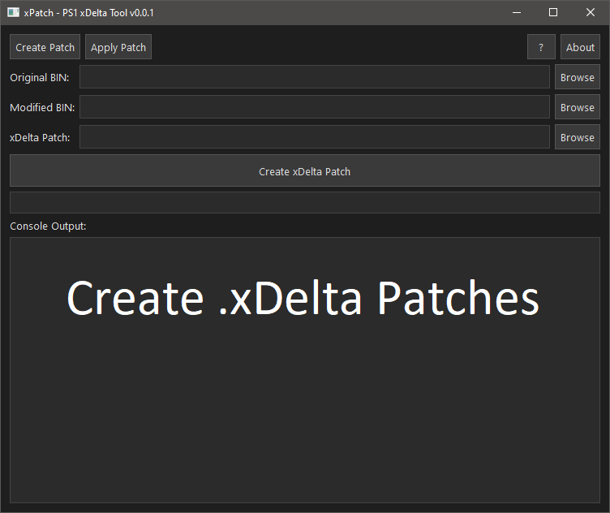
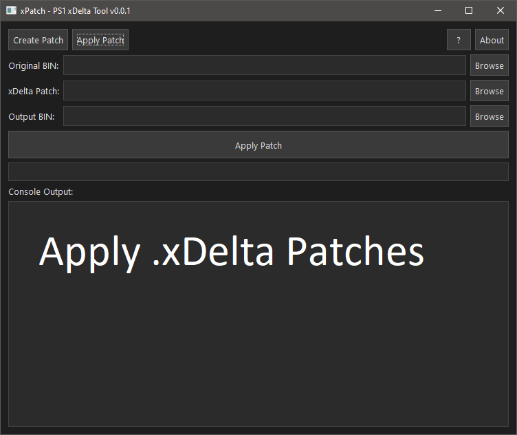
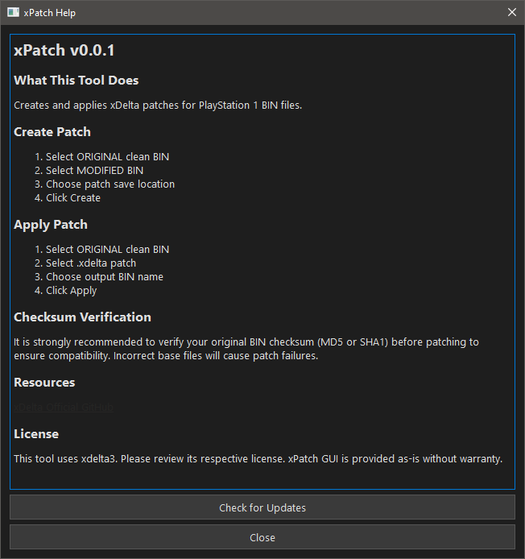

# xPatch


A simple GUI tool to **create and apply `.xdelta` patches** for disk images and ROMs.

---

## Features

- Create `.xdelta` patch files from an original and a modified file
- Apply `.xdelta` / `.xd3` patches to produce a new image
- Supports many common formats:
  - `.bin` / `.cue` (PlayStation and others)
  - `.iso` (CD/DVD images)
  - `.img`, `.mdf`, `.nrg`, `.ccd`
  - `.rom`, `.gcm`, `.chd`, `.cso`, `.wbfs`, `.rvz`, …
- Automatic sidecar copying (`.cue`, `.ccd`, `.sub`, …) when applying a patch
- MD5 / SHA1 checksum helper
- Drag-and-drop support
- Clean, themed PyQt6 interface

---

## What is an `.xdelta` Patch?

`.xdelta` patches are **binary diff files** that store only the differences between two versions of a file.  
They let you:

- Distribute only the changes (much smaller than full ISOs / BINs)
- Apply modifications without sharing copyrighted game data
- Work with large disk images efficiently

Widely used in retro-gaming and ROM-hacking communities.

---

## Screenshots




---

## Requirements (developers)

- Python 3.10+
- PyQt6
- `xdelta3` binary:
  - Place `xdelta3.exe` (Windows) or `xdelta3` in a `tool/` folder next to the project, **or**
  - Have `xdelta3` available on your system `PATH`

## Running from source

```bash
cd newver
python main.py
```

## Building a standalone executable

```bash
cd newver
build.bat          # Windows (uses PyInstaller + xPatch.spec)
```

---

## Credits

- xDelta3: https://github.com/jmacd/xdelta

## Licence

This project is licensed under the MIT License.

###### JEJCo™
